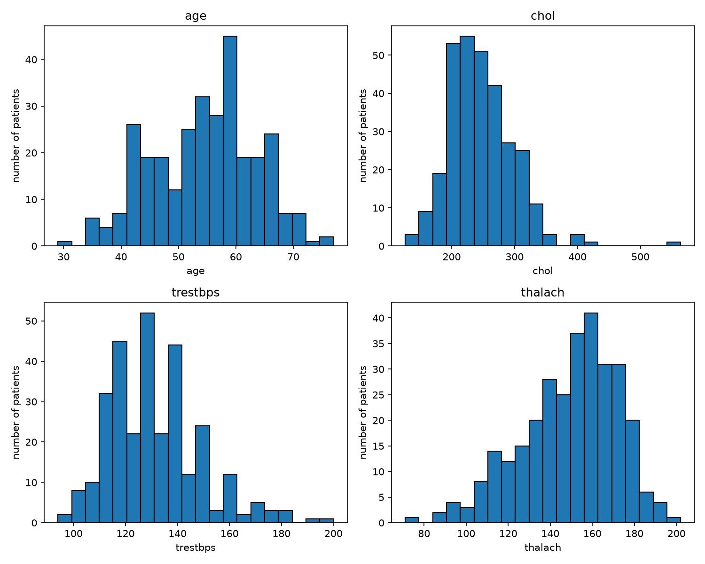
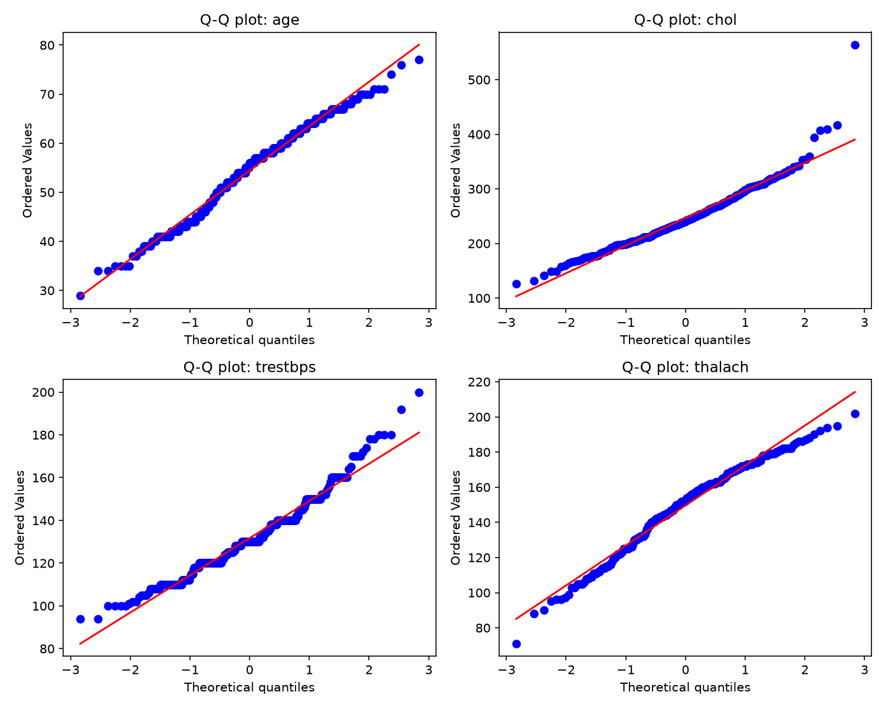
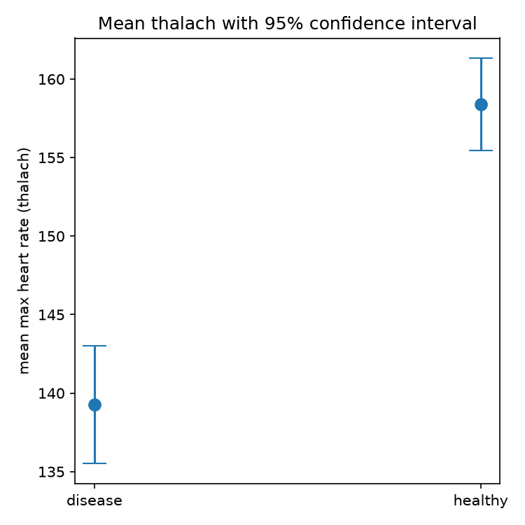
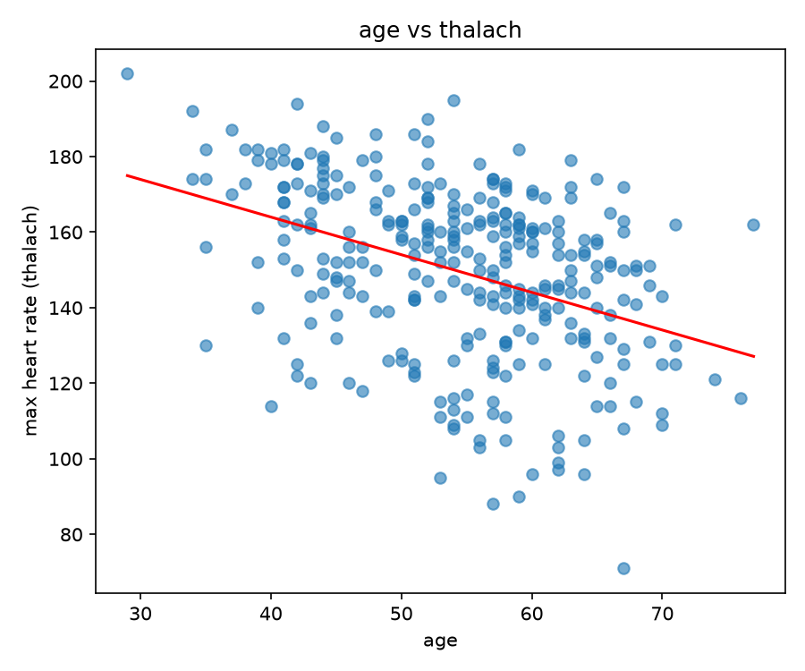
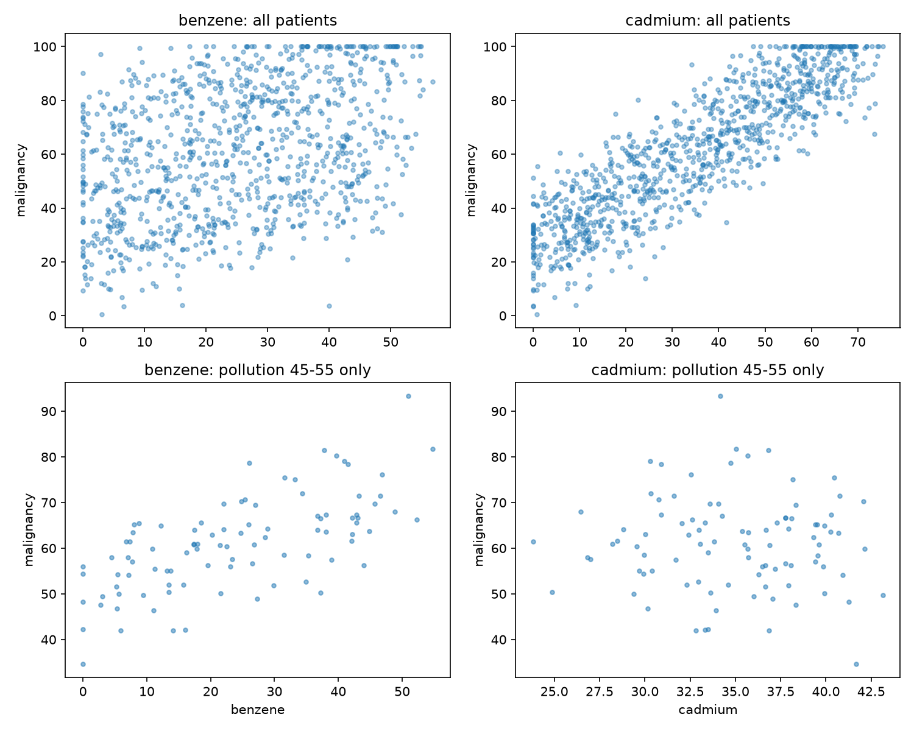

# PW3: Data, Distributions, Testing, and Causation

## What I learned

- I learned to use **pandas**: loading a CSV into a DataFrame, filtering rows
  with a condition, and summarising columns with `describe()`.
- I learned to use **matplotlib (`plt`)**: histograms, Q-Q plots, error-bar
  plots and scatter plots.
- I learned about the **pollution index** and how a hidden third variable can
  make a harmless variable look guilty.

## Data

- Heart data: UCI Heart Disease (Cleveland), from Kaggle
  (https://www.kaggle.com/datasets/ritwikb3/heart-disease-cleveland).
  303 patients, 14 columns, no missing values.
- Chemicals data: synthetic, 1000 patients (benzene, cadmium, pollution_index,
  age, malignancy).

Scripts: `session1.py`, `session2.py`, `dataset2.py`.

## Session 1: Distributions and normality

I checked normality in two ways: graphically (histograms and Q-Q plots) and
numerically (skewness, kurtosis and the Shapiro-Wilk test). All four Shapiro
p-values are below 0.05, but with 303 patients this test reacts even to small
deviations, so I also used the plots and the skewness.

| variable | skew | kurtosis | Shapiro p | verdict |
|---|---|---|---|---|
| age | -0.21 | -0.53 | 0.0061 | approximately normal |
| chol | 1.13 | 4.40 | 0.0000 | not normal |
| trestbps | 0.70 | 0.85 | 0.0000 | not normal |
| thalach | -0.53 | -0.07 | 0.0001 | not normal (mildly) |

- **age:** Almost symmetric (skew -0.21) and the Q-Q dots stay close to the
  line. The small p-value comes from a slightly flat top (kurtosis -0.53).
- **chol:** Strong right skew (1.13) and heavy tail (kurtosis 4.40). The Q-Q
  plot shoots above the line at the top because of an outlier near 560.
- **trestbps:** Right skew (0.70). The values are rounded (120, 130, 140), so
  the Q-Q plot looks like steps, and the upper end bends above the line.
- **thalach:** Left tail (skew -0.53): a few patients reach only 70 to 100.
  The middle of the Q-Q plot is straight, so it is only mildly non-normal.
  I still treat it as not normal, which decides the test in Session 2.

## Session 2: Heart rate in disease vs healthy

I split `thalach` into patients with disease (n = 139) and healthy patients
(n = 164). Because `thalach` is not normal (Session 1), I used the
**Mann-Whitney U test**, which does not assume a normal shape. As a check I
also ran a Welch t-test.

- Mann-Whitney: U = 5806.5, p = 1.9e-13
- Welch t-test: t = -7.86, p = 9.1e-14

**Conclusion:** the groups really differ. Patients with heart disease reach a
lower maximum heart rate.

| group | mean thalach | SEM | 95% CI |
|---|---|---|---|
| disease | 139.3 | 1.92 | +/- 3.8 |
| healthy | 158.4 | 1.50 | +/- 2.9 |

The error bars do not overlap, so the plot agrees with the test.

## Age and heart rate

Pearson r = -0.394 and Spearman rho = -0.392 (both p < 1e-11).

Older patients tend to reach a lower maximum heart rate. The relationship is
moderate, with a lot of scatter around the line. This shows that the variables
move together, not that age is the only cause.

## Dataset 2: The chemical mystery

**Naive analysis (all 1000 patients).** Correlation with malignancy:
benzene r = 0.385, cadmium r = 0.880. At face value, cadmium looks like the
cause.

**Looking again.** I checked the correlation of each variable with
`pollution_index`: cadmium r = 0.982, benzene r = 0.054, malignancy r = 0.895.
So cadmium almost follows the pollution, and pollution is strongly linked to
malignancy. Pollution could be a third variable behind the cadmium result.

**Test.** I kept only patients with similar pollution and recomputed the
correlations with malignancy:

| patients kept | n | benzene r | cadmium r |
|---|---|---|---|
| all (naive) | 1000 | 0.385 | 0.880 |
| pollution 40 to 60 | 199 | 0.702 | 0.316 |
| pollution 45 to 55 | 94 | 0.658 | -0.04 (p = 0.70) |

**Conclusion.** **Benzene is the real cause of malignancy.** When pollution is
held roughly constant, the benzene association stays strong while the cadmium
association disappears. Cadmium only looked guilty because it rises together
with pollution, and pollution itself raises malignancy (a confounding
variable). In the 40 to 60 window, cadmium is still 0.32 because pollution
still varies inside that window and cadmium follows it. In the narrower
45 to 55 window this effect is gone.
